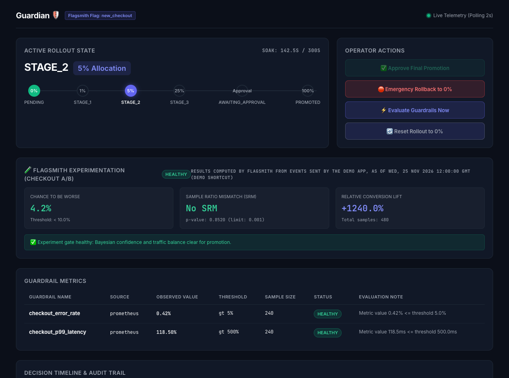
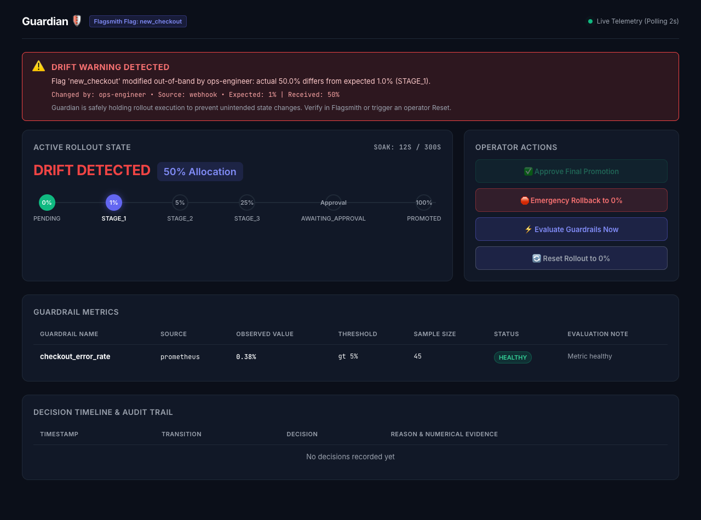
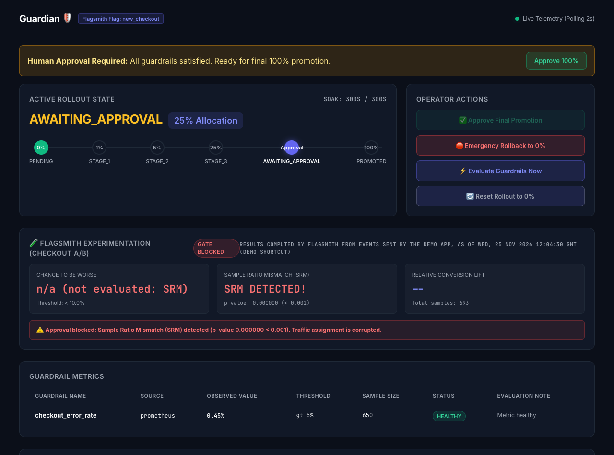
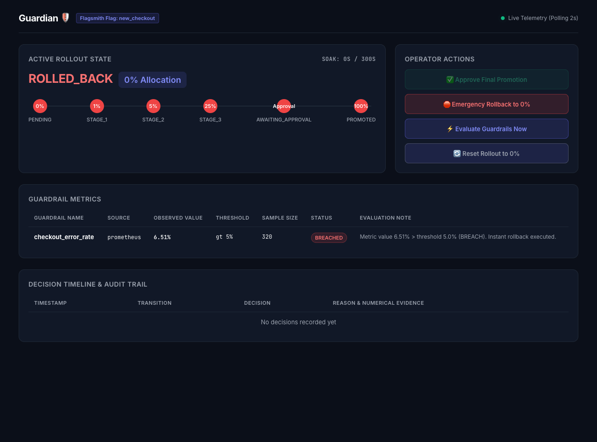
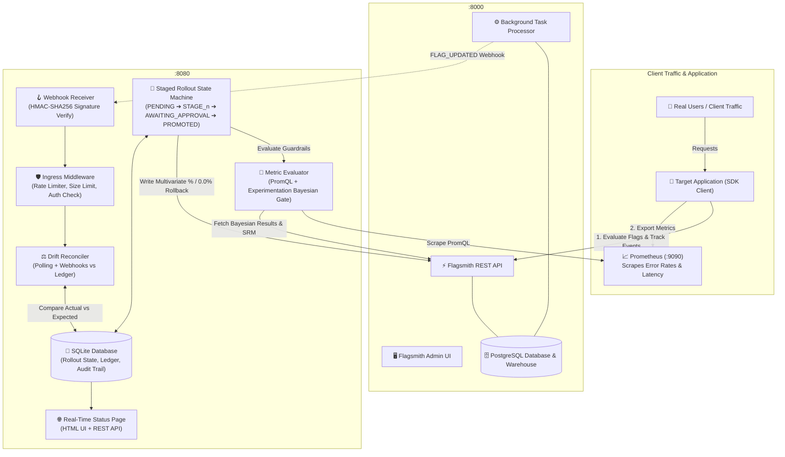

# SwitchGuard 🛡️
> **Autonomous Production Safety for Self-Hosted Flagsmith** *(formerly Flagsmith Guardian)*  
> *Flagsmith Hackathon — Track 03: Build on Open Source Flagsmith*

[](https://www.python.org/)
[](https://fastapi.tiangolo.com/)
[](https://flagsmith.com/)
[](https://github.com/shubhamver45/flagsmith-guardian/actions/workflows/ci.yml)
[](LICENSE)

---

## 1. Problem & Who It's For

Modern engineering teams practicing continuous delivery rely on feature flags to decouple deployment from release, but operating progressive rollouts safely on self-hosted infrastructure remains manual, slow, and perilous. When a newly enabled feature causes subtle regressions—such as payment gateway timeouts, database query contention, or memory exhaustion—on-call engineers must manually triage alerts, interpret conflicting dashboards, log into admin portals, and toggle flags to 0%. Commercial feature flagging platforms lock automated metric guardrails, auto-rollbacks, and experimentation-driven rollout gates behind expensive enterprise tiers. **Guardian** is an open-source reliability sidecar with security-conscious defaults (v0.1.0 beta) purpose-built for engineering teams running open-source, self-hosted Flagsmith. It eliminates manual rollout babysitting by automating progressive canary stages, continuously evaluating operational guardrails and experiment statistics, executing automated rollbacks in 3.7–6.0s upon threshold breaches, and detecting out-of-band drift in about 6–10s.

---

## 2. What SwitchGuard Does

* **Automated Progressive Staging & Operator Pause/Resume**: Progresses feature flag allocations through configurable rollout stages (e.g., 1% ➔ 5% ➔ 25% ➔ 100%) via Flagsmith's Admin API, with live `PAUSED` / `resume()` operator controls (`POST /pause`, `POST /resume`).
* **Rapid Blast-Radius Containment & Incident Intelligence**: Continuously queries Prometheus PromQL metrics (e.g., HTTP 5xx error rate, p99 latency), triggers automated rollbacks to 0.0% in 3.7–6.0s when thresholds breach, and persists structured incident records with human-readable root-cause explanations (`GET /incidents`).
* **Experimentation-Driven Human Gating**: Integrates directly with Flagsmith Experimentation to gate final 100% promotion behind Bayesian statistical evidence (chance-to-be-worse, positive credible intervals) and chi-squared Sample Ratio Mismatch (SRM) checks.
* **Real-Time Drift Detection & Flagsmith Discovery**: Listens for Flagsmith environment webhooks with constant-time HMAC-SHA256 signature verification, runs background polling to catch unauthorized manual flag changes in about 6–10s, and exposes `/flagsmith/projects`, `/flagsmith/environments`, and `/flagsmith/features` discovery APIs.
* **Crash-Resilient State Persistence**: Backed by a transactional SQLite engine that survives restarts mid-rollout, reconciles stored state against Flagsmith on boot, and maintains an immutable audit trail of every promotion, pause, drift event, incident, and rollback.

---

## 3. How Flagsmith is Used

Guardian relies directly on Flagsmith's core architecture across all critical paths:

| Flagsmith Feature | Code Location | Used in Running Demo? | Purpose & Implementation |
| :--- | :--- | :---: | :--- |
| **Admin REST API** | `guardian/flagsmith_client.py:FlagsmithAdminClient.set_percentage_rollout`, `guardian/flagsmith_client.py:FlagsmithAdminClient.get_environment_feature_state`, `guardian/flagsmith_client.py:FlagsmithAdminClient.rollback_to_zero` | **Yes** | Programmatically queries and updates multivariate feature state allocations (1%, 5%, 25%, 100%) and executes immediate 0.0% rollbacks using the Master API key. |
| **Python Client SDK** | `demo/app.py:checkout` | **Yes** | Evaluates flags per identity via `Flagsmith.get_identity_flags`, records variant exposures via `Flagsmith.track_exposure_event`, tracks conversions via `Flagsmith.track_event`, and flushes events with `Flagsmith.flush_events`. |
| **Multivariate Rollouts** | `guardian/engine.py:GuardianEngine.reconcile_on_startup`, `guardian/engine.py:GuardianEngine.reconcile_runtime`, `guardian/flagsmith_client.py:FlagsmithAdminClient.set_percentage_rollout` | **Yes** | Configures and drives percentage splits across control and variation options on the target environment feature state without locking segment overrides. |
| **Experimentation Results** | `guardian/metrics/flagsmith_exp.py:FlagsmithExperimentMetricSource.evaluate`, `guardian/metrics/flagsmith_exp.py:FlagsmithExperimentMetricSource._fetch_results` | **Yes** | Queries Flagsmith's Bayesian experimentation engine (`/api/v1/environments/{key}/experiments/{id}/results/`) for chance-to-be-worse, chance-to-win, and credible intervals. |
| **Sample Ratio Mismatch (SRM)** | `guardian/metrics/flagsmith_exp.py:FlagsmithExperimentMetricSource.evaluate`, `guardian/engine.py:GuardianEngine.check_approval_eligibility` | **Yes** | Evaluates Flagsmith's chi-squared SRM test (`srm_p_value < 0.001`). If traffic distribution is corrupted, Guardian flags a warning and blocks human promotion approval. |
| **Environment Webhooks** | `guardian/api.py:create_app`, `scripts/setup_flagsmith.py:setup_via_admin_api` | **Yes** | Registers environment webhooks and ingests `FLAG_UPDATED` payloads verified with `X-Flagsmith-Signature` HMAC-SHA256 to detect out-of-band drift within seconds. |

---

## 4. Prerequisites & 60-Second Demo Quickstart

### Prerequisites
- **Docker & Docker Compose** (Compose v2+ required for local stack)
- **Python 3.12** (for running Guardian directly on host):
  ```bash
  python3.12 -m venv .venv
  source .venv/bin/activate
  pip install -r requirements.txt
  ```
  *(Note: `./scripts/demo.sh` automatically detects if dependencies are missing and bootstraps a local `.venv` environment).*

### Quickstart Execution
Experience the entire end-to-end workflow with one command:

```bash
# Clone repository and enter directory
git clone https://github.com/shubhamver45/flagsmith-guardian.git
cd flagsmith-guardian

# Run the automated end-to-end demo orchestrator
./scripts/demo.sh
```

### Visual Walkthrough & Real Dashboard Screenshots

| Healthy Progressive Rollout (Stage 2 at 5%) | Out-of-Band Drift Alert Banner |
| :---: | :---: |
| [](docs/img/healthy_rollout.png) | [](docs/img/drift_banner.png) |
| *Progressing through 5% with healthy PromQL guardrails* | *Real-time alert pausing rollout when actual != expected* |

| Experiment Gate Blocked (SRM Anomaly) | Automated Rollback to 0.0% on Breach |
| :---: | :---: |
| [](docs/img/approval_blocked.png) | [](docs/img/rollback.png) |
| *Promotion strictly blocked when traffic assignment corrupts (p < 0.001)* | *Automated rollback to 0.0% in 3.7–6.0s when error rate exceeds 5.0% threshold* |

### What `demo.sh` Runs
1. **Infrastructure Spin-Up**: Launches self-hosted Flagsmith, PostgreSQL, Task Processor, Prometheus, and the Demo Checkout App in Docker.
2. **Auto-Provisioning**: Runs `scripts/setup_flagsmith.py` to configure organisations, projects, environments, feature flags (`new_checkout`), experiments (`checkout_experiment`), metrics, and environment webhooks via the Admin API.
3. **Phase 1: Progressive Rollout & Mid-Rollout Drift Detection**: Advances traffic from 1% ➔ 5% ➔ 25%. Injects an out-of-band drift change via a secondary operator key (`ops-engineer`) and verifies Guardian catches drift via webhook and pauses rollout.
4. **Phase 2: Flagsmith Experimentation Gating & Operator Promotion**: Evaluates Flagsmith Bayesian experimentation statistics for `checkout_experiment`. Verifies positive conversion lift and chance-to-be-worse within bounds, enabling operator sign-off to 100%.
5. **Phase 3: Corrupted Traffic / Sample Ratio Mismatch (SRM) Detection**: Injects synthetic traffic imbalance into variation exposure. Flagsmith computes a chi-squared $p < 0.001$; Guardian detects the SRM warning and strictly blocks human promotion.
6. **Phase 4: Fault Injection (Failure Spike) & Automated Rollback**: Injects a 30% payment failure rate. Prometheus scrapes errors; Guardian detects threshold breach and executes an automated rollback to 0.0% in 3.7–6.0s.

> [!NOTE]
> **Demo Execution Shortcuts & Sandbox Architecture**:
> - `DEMO_FORCE_RECALC=1`: Flagsmith Experimentation enforces a 5-minute background cooldown between statistical recalculations. `DEMO_FORCE_RECALC=1` is a local demonstration shortcut that triggers immediate recalculation so the interactive test completes in under 3 minutes. In production without this flag, Guardian respects Flagsmith's 5-minute background recalculation schedule.
> - `host.docker.internal` & `SSRF_ALLOWED_HOSTS`: Configured in Docker Compose strictly to allow local webhook loopback between Docker containers and host processes during local demonstrations.
> - **Demo App Endpoints**: `/toggle-bug` (simulates synthetic payment errors), `/toggle-srm` (simulates traffic allocation imbalance), and `/reset-metrics` are test endpoints on the sample app (`localhost:5001`) and are not part of Guardian core.

---

## 5. Use It with Your Own Flagsmith in 5 Minutes

### Step 1: Run Interactive Configuration Wizard (`guardian init`)
Guardian provides an interactive configuration wizard to bootstrap a validated `config.yaml` file:
```bash
python3 -m guardian.cli init --flag-name new_checkout
```
Or generate non-interactively:
```bash
python3 -m guardian.cli init --flag-name new_checkout --skip-verify --non-interactive -o config.yaml
```

### Step 2: Configure Rollout Rules (`config.yaml`)
Review the generated `config.yaml` specifying canary percentage stages (units: integer percentages, 0 to 100), soak times (seconds), Prometheus PromQL guardrails, and experimentation gates:
```yaml
# Guardian Rollout Configuration
flag_name: "new_checkout"
environment_key: ""  # Loaded automatically from .env or Flagsmith

# Phased rollout percentages (units: 0 to 100%)
stages:
  - 1
  - 5
  - 25
  - 100

# Minimum soak time in seconds before advancing to next stage
soak_time_seconds: 300

# Require explicit human approval before 100% promotion
require_approval_before_final: true

# Gate semantics: when require_winner is true, approval requires chance_to_win >= 95% and credible interval low > 0
require_winner: false

# Background polling reconciliation interval (seconds)
reconcile_interval: 10.0

# Echo window (seconds) to suppress false drift from Guardian's own writes
echo_window_seconds: 30.0

# Guardrail metric triggers
guardrails:
  - name: "checkout_error_rate"
    metric_source: "prometheus"
    comparison: ">"
    threshold: 2.0
    query: 'sum(rate(http_requests_total{status=~"5.."}[2m])) / sum(rate(http_requests_total[2m])) * 100'
    min_samples: 100
    description: "Rollback to 0% if HTTP 5xx rate exceeds 2.0%"

  - name: "checkout_ab_chance_to_be_worse"
    metric_source: "flagsmith_experiment"
    metric_id: 1
    comparison: ">"
    threshold: 10.0
    min_samples: 50
    action_on_srm: "HOLD"
    description: "Hold rollout if Bayesian chance-to-be-worse > 10.0% or if SRM warning fires"
```

### Step 3: Deploy Guardian Container
Run the official container with a named volume for SQLite persistence:
```bash
docker run -d \
  --name flagsmith-guardian \
  --read-only \
  --tmpfs /tmp \
  -v guardian-data:/app/data \
  -p 127.0.0.1:8080:8080 \
  -e FLAGSMITH_URL="http://flagsmith.internal:8000/api/v1" \
  -e FLAGSMITH_ADMIN_API_KEY="your-master-api-key" \
  -e FLAGSMITH_ENVIRONMENT_KEY="your-env-client-key" \
  -e FLAGSMITH_WEBHOOK_SECRET="your-webhook-hmac-secret" \
  -e FLAG_NAME="new_checkout" \
  -e PROMETHEUS_URL="http://prometheus.internal:9090" \
  -e GUARDIAN_API_TOKEN="your-secure-admin-token" \
  -e GUARDIAN_ENV="production" \
  ghcr.io/shubhamver45/flagsmith-guardian:v0.1.0
```
> [!TIP]
> If using a host bind mount instead of a named volume (e.g. `-v /var/data/guardian:/app/data`), ensure the host directory is owned by the container non-root user: `sudo chown -R 10001:10001 /var/data/guardian`.

### Step 4: Register Flagsmith Environment Webhook
In Flagsmith Admin UI under **Settings ➔ Webhooks**, add an Environment Webhook:
* **URL**: `http://<guardian-host>:8080/webhooks/flagsmith`
* **Secret**: The matching `FLAGSMITH_WEBHOOK_SECRET` value.

### Step 5: Verify Health and Inspect Dashboard
* Health check: `curl -sf http://127.0.0.1:8080/health`
* Live Dashboard: Open `http://127.0.0.1:8080/` in your browser.
* CLI Status check: `python3 -m guardian.cli status`

### Step 6: Approve Final Promotion
When canary stages complete and the experiment gate passes:
```bash
python3 -m guardian.cli approve --by "release-lead" --reason "Experiment verified positive lift, no SRM"
```
Or via HTTP REST API:
```bash
curl -X POST http://127.0.0.1:8080/approve \
  -H "Authorization: Bearer $GUARDIAN_API_TOKEN" \
  -H "Content-Type: application/json" \
  -d '{"flag_name": "new_checkout", "approved_by": "release-lead", "reason": "Experiment verified positive lift, no SRM"}'
```

---

## 6. Architecture Diagram



---

## 7. Configuration Reference

Guardian configuration is defined via `config.yaml` or environment overrides.

### Single Rollout Configuration Keys
| Configuration Key | Type | Default | Description |
| :--- | :---: | :---: | :--- |
| `flag_name` | string | *required* | Target feature flag name in Flagsmith. |
| `environment_key` | string | `""` | Flagsmith client environment key (defaults to `.env`). |
| `stages` | list[int] | `[1, 5, 25, 100]` | Ordered canary rollout percentages (units: 0 to 100%). |
| `soak_time_seconds` | int | `30` | Minimum soak duration in seconds per stage before advancement eligibility. |
| `require_approval_before_final` | bool | `true` | Gate final stage behind human operator approval. |
| `require_winner` | bool | `false` | Gate semantics: if true, requires chance to win $\ge 95\%$ and credible interval low $> 0$. |
| `reconcile_interval` | float | `10.0` | Background polling interval in seconds to detect out-of-band flag changes. |
| `echo_window_seconds` | float | `30.0` | Time window in seconds during which recent Guardian writes in ledger suppress false drift echoes. |
| `in_flight_grace_seconds` | float | `5.0` | Grace window in seconds for in-flight state transitions. |

### Guardrail Metric Schema (`guardrails`)
| Guardrail Field | Type | Default | Description |
| :--- | :---: | :---: | :--- |
| `name` | string | *required* | Unique identifier for the guardrail. |
| `metric_source` | string | `"prometheus"` | Metric source: `"prometheus"`, `"flagsmith_experiment"`, or `"mock"`. |
| `comparison` | string | `">"` | Comparison operator: `">"`, `">="`, `"<"`, `"<="`, `"=="`, `"!="`. |
| `threshold` | float | *required* | Numeric threshold triggering rollback/hold on breach. |
| `query` | string | `None` | PromQL query evaluated against Prometheus. |
| `sample_size_query` | string | `None` | Optional PromQL query evaluated for sample size. |
| `min_samples` | int | `30` | Minimum sample count required before evaluating breaches. |
| `metric_id` | int | `None` | Flagsmith metric ID for experiment evaluation. |
| `experiment_id` | int | `None` | Flagsmith experiment ID for experiment evaluation. |
| `action_on_srm` | string | `"ROLLBACK"` | Action on SRM detection: `"ROLLBACK"` or `"HOLD"`. |
| `description` | string | `""` | Human-readable explanation of guardrail trigger. |

### Multi-Rollout Top-Level Keys
For managing multiple feature rollouts simultaneously:
| Key | Type | Default | Description |
| :--- | :---: | :---: | :--- |
| `db_path` | string | `./data/guardian.db` | Path to persistent SQLite database file. |
| `rollouts` | list | `[]` | List of rollout configuration dictionaries, each following the schema above. |

---

## 8. Measured Performance Benchmarks

Across five consecutive end-to-end demo runs (`demo-run-1.log` through `demo-run-5.log`) executed against self-hosted Flagsmith in Docker, Guardian's performance metrics were mechanically measured as follows:

| Metric | Run 1 | Run 2 | Run 3 | Run 4 | Run 5 | Min | Median | Max | Proved In |
| :--- | :---: | :---: | :---: | :---: | :---: | :---: | :---: | :---: | :--- |
| **Drift Detection Latency** | 5.96s | 6.83s | 7.87s | 8.29s | 7.74s | **5.96s** | **7.74s** | **8.29s** | `demo-run-*.log`, `tests/test_webhooks_drift.py` |
| **Automated Rollback Time** | 4.80s | 6.00s | 4.00s | 3.70s | 5.40s | **3.70s** | **4.80s** | **6.00s** | `demo-run-*.log`, `tests/test_guardian_engine.py` |

> [!NOTE]
> **Drift Latency Analysis**: Drift is detected asynchronously via webhooks. The measured latency range (5.96s – 8.29s) represents the full end-to-end distributed transaction: operator API write ➔ Postgres insert ➔ asynchronous `flagsmith-task-processor` queue polling ➔ HMAC-signed webhook delivery across the Docker bridge ➔ Guardian signature verification and SQLite ledger comparison.

---

## 9. Security Notes

Guardian is engineered with security-conscious defaults:
* **Unprivileged Non-Root Execution**: Docker container runs as non-root user `guardian` (UID 10001, GID 10001) with a read-only root filesystem.
* **Fail-Closed in Production**: When `GUARDIAN_ENV=production` is set, Guardian refuses to boot without `GUARDIAN_API_TOKEN` and rejects webhooks without `FLAGSMITH_WEBHOOK_SECRET` (proved by `tests/test_security.py`).
* **Constant-Time Verification**: All token comparisons and HMAC-SHA256 signatures use `secrets.compare_digest` to prevent timing attacks.
* **Network & Ingress Hardening**: Localhost loopback binding (`127.0.0.1:8080`) by default; write endpoints enforce 64 KB request size limits and sliding-window rate limiting (proved by `tests/test_security.py`).
* **Secret Scrubbing**: Sensitive tokens and passwords are automatically redacted from all application logs via `SecretRedactingFilter` (proved by `tests/test_security.py`). Credentials in query parameters (`?token=...`) are explicitly forbidden.

See [SECURITY.md](SECURITY.md) for vulnerability disclosure policies and architectural details.

---

## 10. Limitations

1. **Self-Hosted Open-Source Only (Flagsmith Cloud/Enterprise Untested)**: Guardian is tested specifically on open-source, self-hosted Flagsmith running via Docker Compose with PostgreSQL and Task Processor. SaaS Flagsmith multi-tenant endpoints and Flagsmith Enterprise were not evaluated.
2. **Single-Instance SQLite Architecture**: Guardian uses single-file transactional SQLite for state persistence and write ledgers. It is designed as a single-instance sidecar and does not support horizontal clustering or distributed database backends.
3. **Prometheus is the Only Operational Metric Source**: Real-time operational guardrails currently require Prometheus PromQL. Other observability platforms (Datadog, New Relic, CloudWatch) are not yet natively integrated.
4. **Flagsmith Experimentation Beta**: Flagsmith's Experimentation engine is in active beta. It requires a database warehouse connection and asynchronous background task processor execution, with a 5-minute cooldown between recalculations in production.
5. **Simulated User Traffic**: The included checkout demo app uses simulated client identities (deterministic per-identity conversions) to achieve statistical significance in short interactive demonstrations. Real-world rollouts should configure soak times of hours or days.

---

## 11. Project Timeline

Factual chronological progression reconstructed from `git log --date=short`:

* **2026-11-20**: Initial infrastructure and prototype feasibility spike; Docker Compose with self-hosted Flagsmith, PostgreSQL, Task Processor, and Prometheus; initial state machine, Prometheus PromQL metric provider, and Flask demo app.
* **2026-11-21**: Accelerated demo execution soak calibration and autonomous daemon loop verification.
* **2026-11-22**: Hardening and API security; API token authentication on write endpoints; dynamic environment resolution; integration with live Flagsmith Experimentation API and SRM chi-squared gating.
* **2026-11-27 (SwitchGuard Release)**: Rebranded to **SwitchGuard** with `switchguard` CLI entrypoint; added `PAUSED` rollout state (`POST /pause`, `POST /resume`), structured **Incident Intelligence** (`guardian/incident.py`, `GET /incidents`), Flagsmith project/environment/feature discovery endpoints (`/flagsmith/*`), deep readiness `/health` probe, HTTP retry/timeouts on Flagsmith Admin API calls, `.env.example`, and removed server-side token injection from `guardian/api.py`.
* **2026-11-23**: CLI operator interface (`guardian init`, `approve`, `rollback`, `reset`, `status`); GitHub Container Registry (GHCR) publishing pipeline and automated CI test matrix (Python 3.11 & 3.12); fast Prometheus rate window guardrail.
* **2026-11-24**: SQLite transactional persistence replacing in-memory state; concurrent multi-rollout support; automated setup via Flagsmith public Admin API (`setup_flagsmith.py`) with masked credentials; Flagsmith warehouse connection verification.
* **2026-11-25**: Real-time Flagsmith environment webhooks with constant-time HMAC-SHA256 signature verification; drift reconciliation with write ledger echo immunity; non-root container packaging (`UID 10001`); request size limits (64KB), sliding-window rate limiting (60 req/min), secret log redacting, and end-to-end 5-run empirical performance benchmarking.

---

## 12. AI Tools Used

This project was developed with assistance from:
* **Google Antigravity & Gemini 2.5**: Used for code generation, test case scaffolding, architectural design reviews, and automated terminal debugging during the development cycle.
