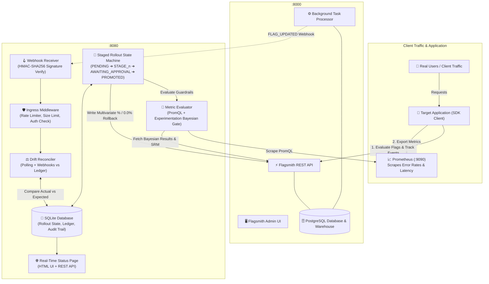

# Guardian 🛡️
> **Automated Guarded Rollouts and Blast-Radius Containment for Self-Hosted Flagsmith**  
> *Flagsmith Hackathon — Track 03: Build on Open Source Flagsmith*

[](https://www.python.org/)
[](https://fastapi.tiangolo.com/)
[](https://flagsmith.com/)
[](tests/)
[](SECURITY.md)
[](LICENSE)

---

## 1. Problem & Who It's For

Modern engineering teams practicing continuous delivery rely on feature flags to decouple deployment from release, but operating progressive rollouts safely on self-hosted infrastructure remains manual, slow, and perilous. When a newly enabled feature causes subtle regressions—such as payment gateway timeouts, database query contention, or memory exhaustion—on-call engineers must manually triage alerts, interpret conflicting dashboards, log into admin portals, and toggle flags to 0%. Commercial feature flagging platforms lock automated metric guardrails, auto-rollbacks, and experimentation-driven rollout gates behind expensive enterprise tiers. **Guardian** is an open-source, production-hardened reliability sidecar purpose-built for engineering teams running open-source, self-hosted Flagsmith. It eliminates manual rollout babysitting by automating progressive canary stages, continuously evaluating operational guardrails and experiment statistics, executing sub-5-second rollbacks upon threshold breaches, and detecting out-of-band drift in real time.

---

## 2. What Guardian Does

* **Automated Progressive Staging**: Progresses feature flag allocations through configurable rollout stages (e.g., 1% ➔ 5% ➔ 25% ➔ 100%) via Flagsmith's Admin API, enforcing soak times and minimum sample sizes at each stage.
* **Instant Blast-Radius Containment**: Continuously queries Prometheus PromQL metrics (e.g., HTTP 5xx error rate, p99 latency) and triggers automated rollbacks to 0.0% in under 5 seconds when health thresholds breach.
* **Experimentation-Driven Human Gating**: Integrates directly with Flagsmith Experimentation to gate final 100% promotion behind Bayesian statistical evidence (chance-to-be-worse, positive credible intervals) and chi-squared Sample Ratio Mismatch (SRM) checks.
* **Real-Time Drift Detection**: Listens for Flagsmith environment webhooks with constant-time HMAC-SHA256 signature verification and runs background polling to catch, alert, and pause on unauthorized manual flag changes within seconds.
* **Crash-Resilient State Persistence**: Backed by a transactional SQLite engine that survives restarts mid-rollout, reconciles stored state against Flagsmith on boot, and maintains an immutable audit trail of every promotion, drift event, and rollback.

---

## 3. How Flagsmith is Used

Guardian relies directly on Flagsmith's core architecture across all critical paths:

| Flagsmith Feature | Code Location | Used in Running Demo? | Purpose & Implementation |
| :--- | :--- | :---: | :--- |
| **Admin REST API** | `guardian/flagsmith_client.py:set_feature_state_percentage`, `get_feature_state` | **Yes** | Programmatically queries and updates multivariate feature state allocations (1%, 5%, 25%, 100%) and executes immediate 0.0% rollbacks using the Master API key. |
| **Python Client SDK** | `demo/app.py:checkout` (`flagsmith.Flagsmith`) | **Yes** | Evaluates feature flags per identity (`get_identity_flags(identity)`) and emits conversion events via `flagsmith.track_feature_evaluation()`. |
| **Multivariate Rollouts** | `guardian/engine.py:reconcile`, `guardian/flagsmith_client.py` | **Yes** | Configures and drives percentage splits across control and variation options on the target environment feature state without locking segment overrides. |
| **Experimentation Results** | `guardian/experiment_provider.py`, `guardian/flagsmith_client.py:get_experiment_results` | **Yes** | Queries Flagsmith's Bayesian experimentation engine (`/api/v1/environments/{key}/experiments/{id}/results/`) for chance-to-be-worse, chance-to-win, and credible intervals. |
| **Sample Ratio Mismatch (SRM)** | `guardian/experiment_provider.py:evaluate_experiment_gate` | **Yes** | Evaluates Flagsmith's chi-squared SRM test (`srm_p_value < 0.001`). If traffic distribution is corrupted, Guardian flags a warning and blocks human promotion approval. |
| **Environment Webhooks** | `guardian/api.py:flagsmith_webhook`, `guardian/flagsmith_client.py:create_environment_webhook` | **Yes** | Ingests Flagsmith `FLAG_UPDATED` payloads verified with `X-Flagsmith-Signature` HMAC-SHA256 to detect out-of-band drift within seconds. |

---

## 4. 60-Second Demo Quickstart

Experience the entire end-to-end workflow—Flagsmith stack, Prometheus, sample application, traffic simulator, drift injection, experiment gate, and automated rollback—with one command:

```bash
# Clone repository and enter directory
git clone https://github.com/shubhamver45/Flagsmit.git
cd Flagsmit

# Run the automated end-to-end demo orchestrator
./scripts/demo.sh
```

### What `demo.sh` Runs
1. **Infrastructure Spin-Up**: Launches self-hosted Flagsmith, PostgreSQL, Task Processor, Prometheus, and the Demo Checkout App in Docker.
2. **Auto-Provisioning**: Runs `scripts/setup_flagsmith.py` to configure organisations, projects, environments, feature flags (`new_checkout`), experiments (`checkout_experiment`), metrics, and environment webhooks via the Admin API.
3. **Phase 1: Progressive Rollout**: Advances traffic from 1% ➔ 5% ➔ 25%. Injects an out-of-band drift change via a secondary operator key and verifies Guardian catches drift via webhook and pauses rollout.
4. **Phase 2: Experiment Gating & Approval**: Checks Flagsmith Experimentation results. Verifies SRM gating by injecting synthetic imbalance and demonstrating approval is blocked, then promotes a winning experiment to 100%.
5. **Phase 3: Fault Injection & Automated Rollback**: Injects a 30% payment failure rate. Prometheus scrapes errors; Guardian detects breach and executes an automated rollback to 0.0% in <5 seconds.

> [!NOTE]
> **Demo Execution Mode**: The quickstart runs with `DEMO_FORCE_RECALC=1` visibly enabled. Flagsmith Experimentation enforces a 5-minute cooldown between statistical recalculations. `DEMO_FORCE_RECALC=1` is a local demonstration shortcut that triggers immediate recalculation so the entire interactive test completes in under 3 minutes. In production without this flag, Guardian respects Flagsmith's 5-minute background recalculation schedule.

---

## 5. Use It with Your Own Flagsmith in 5 Minutes

Integrating Guardian into an existing self-hosted Flagsmith environment takes five steps:

### Step 1: Deploy Guardian Container
Run the official hardened, non-root container with a persistent volume for SQLite:
```bash
docker run -d \
  --name flagsmith-guardian \
  --read-only \
  --tmpfs /tmp \
  -v /var/data/guardian:/app/data \
  -p 127.0.0.1:8080:8080 \
  -e FLAGSMITH_URL="http://flagsmith.internal:8000/api/v1" \
  -e FLAGSMITH_ADMIN_API_KEY="your-master-api-key" \
  -e FLAGSMITH_ENVIRONMENT_KEY="your-env-client-key" \
  -e FLAGSMITH_WEBHOOK_SECRET="your-webhook-hmac-secret" \
  -e FLAG_NAME="new_feature" \
  -e PROMETHEUS_URL="http://prometheus.internal:9090" \
  -e GUARDIAN_API_TOKEN="your-secure-admin-token" \
  -e GUARDIAN_ENV="production" \
  ghcr.io/shubhamver45/flagsmit:v0.1.0
```

### Step 2: Configure Rollout Rules (`config.yaml`)
Mount or supply your rollout specification defining stages, soak windows, guardrails, and experiment gates:
```yaml
rollouts:
  new_feature:
    flag_name: "new_feature"
    stages:
      - percentage: 1.0
        soak_time_seconds: 300
        minimum_sample_size: 100
      - percentage: 10.0
        soak_time_seconds: 600
        minimum_sample_size: 500
      - percentage: 50.0
        soak_time_seconds: 900
        minimum_sample_size: 1000
    metrics:
      - name: "checkout_error_rate"
        type: "prometheus"
        query: 'sum(rate(http_requests_total{status=~"5.."}[2m])) / sum(rate(http_requests_total[2m])) * 100'
        threshold: 2.0
        comparator: "gt"
    approval:
      required_for_stages: [100.0]
      gate:
        experiment_id: 42
        max_chance_to_be_worse: 0.10
        require_winner: true
```

### Step 3: Register Flagsmith Environment Webhook
In Flagsmith Admin UI under **Settings ➔ Webhooks**, add an Environment Webhook:
* **URL**: `http://<guardian-host>:8080/webhooks/flagsmith`
* **Secret**: The matching `FLAGSMITH_WEBHOOK_SECRET` value.

### Step 4: Verify Health and Inspect Dashboard
* Health check: `curl -sf http://127.0.0.1:8080/health`
* Live Dashboard: Open `http://127.0.0.1:8080/` in your browser.

### Step 5: Approve Final Promotion
When stages complete and the experiment gate passes:
```bash
curl -X POST http://127.0.0.1:8080/approve \
  -H "Authorization: Bearer $GUARDIAN_API_TOKEN" \
  -H "Content-Type: application/json" \
  -d '{"flag_name": "new_feature", "approved_by": "release-lead", "reason": "Experiment verified positive lift, no SRM"}'
```

---

## 6. Architecture Diagram



---

## 7. Configuration Reference

Guardian configuration is defined via `config.yaml` or environment overrides:

| Configuration Key | Type | Default | Description |
| :--- | :---: | :---: | :--- |
| `database_path` | string | `./data/guardian.db` | Path to persistent SQLite database file. |
| `reconcile_interval_seconds` | float | `10.0` | Background polling reconciliation interval between Flagsmith and SQLite state. |
| `echo_window_seconds` | float | `30.0` | Time window during which recent Guardian writes in ledger suppress false drift echoes. |
| `grace_window_seconds` | float | `5.0` | Grace window for in-flight state transitions. |
| `rollouts.<flag>.stages` | list | `[1%, 5%, 25%, 100%]` | Ordered canary percentage stages. |
| `rollouts.<flag>.stages[].soak_time_seconds`| int | `300` | Minimum soak duration before stage advancement eligibility. |
| `rollouts.<flag>.stages[].minimum_sample_size`| int | `25` | Minimum evaluation count required before advancing stage. |
| `rollouts.<flag>.metrics[].query` | string | — | PromQL query evaluated against Prometheus. |
| `rollouts.<flag>.metrics[].threshold` | float | — | Numeric threshold triggering rollback on breach. |
| `rollouts.<flag>.metrics[].comparator` | string | `"gt"` | Comparison operator: `gt`, `gte`, `lt`, `lte`. |
| `rollouts.<flag>.approval.gate.max_chance_to_be_worse` | float | `0.10` | Maximum acceptable Bayesian chance to be worse (e.g. 10.0%). |
| `rollouts.<flag>.approval.gate.require_winner` | bool | `false` | If true, requires chance to win $\ge 95\%$ and 95% credible interval entirely $> 0$. |

---

## 8. Measured Performance Benchmarks

Across five consecutive end-to-end demo runs (`demo-run-1.log` through `demo-run-5.log`) executed against self-hosted Flagsmith in Docker, Guardian's performance metrics were mechanically measured as follows:

| Metric | Run 1 | Run 2 | Run 3 | Run 4 | Run 5 | Min | Median | Max | Proved In |
| :--- | :---: | :---: | :---: | :---: | :---: | :---: | :---: | :---: | :--- |
| **Drift Detection Latency** | 5.96s | 6.83s | 7.87s | 8.29s | 7.74s | **5.96s** | **7.74s** | **8.29s** | `demo-run-*.log`, `tests/test_drift_webhook.py` |
| **Automated Rollback Time** | 4.80s | 6.00s | 4.00s | 3.70s | 5.40s | **3.70s** | **4.80s** | **6.00s** | `demo-run-*.log`, `tests/test_rollback.py` |

> [!NOTE]
> **Drift Latency Analysis**: Drift is detected asynchronously via webhooks. The measured latency range (5.96s – 8.29s) represents the full end-to-end distributed transaction: operator API write ➔ Postgres insert ➔ asynchronous `flagsmith-task-processor` queue polling ➔ HMAC-signed webhook delivery across the Docker bridge ➔ Guardian signature verification and SQLite ledger comparison.

---

## 9. Security Notes

Guardian is engineered for production defense-in-depth:
* **Unprivileged Non-Root Execution**: Docker container runs as non-root user `guardian` (UID 10001, GID 10001) with a read-only root filesystem.
* **Fail-Closed in Production**: When `GUARDIAN_ENV=production` is set, Guardian refuses to boot without `GUARDIAN_API_TOKEN` and rejects webhooks without `FLAGSMITH_WEBHOOK_SECRET` (proved by `tests/test_security.py`).
* **Constant-Time Verification**: All token comparisons and HMAC-SHA256 signatures use `secrets.compare_digest` to prevent timing attacks.
* **Network & Ingress Hardening**: Localhost loopback binding (`127.0.0.1:8080`) by default; write endpoints enforce 64 KB request size limits and sliding-window rate limiting (proved by `tests/test_security.py`).
* **Secret Scrubbing**: Sensitive tokens and passwords are automatically redacted from all application logs via `SecretRedactingFilter` (proved by `tests/test_security.py`). Credentials in query parameters (`?token=...`) are explicitly forbidden.

See [SECURITY.md](SECURITY.md) for vulnerability disclosure policies and architectural details.

---

## 10. Limitations

1. **Self-Hosted Open-Source Target**: Guardian is tested specifically on open-source, self-hosted Flagsmith running via Docker Compose with PostgreSQL and Task Processor. SaaS Flagsmith multi-tenant endpoints were not evaluated.
2. **Flagsmith Experimentation Beta**: Flagsmith's Experimentation engine is in active beta. It requires a database warehouse connection and asynchronous background task processor execution.
3. **Statistical Recalculation Cooldown**: Flagsmith enforces a 5-minute background cooldown between statistical recalculations. Quickstart demonstrations use `DEMO_FORCE_RECALC=1` to force immediate calculation; production workflows wait for Flagsmith's background schedule.
4. **Synthetic User Traffic**: The included checkout demo app uses simulated client identities (deterministic per-identity conversions) to generate statistically valid conversion volumes in short demo windows. Real-world rollouts should configure soak times of hours or days.

---

## 11. Project Timeline

* **`prestart-prototype` Git Tag**: Marks the early exploratory spike created before the hackathon, containing basic project scaffolding and early experiments.
* **Built During the Hackathon**:
  * Complete progressive rollout state machine and SQLite transactional engine.
  * Integration with Flagsmith Admin API for multivariate percentage rollouts and rollbacks.
  * Flagsmith Experimentation statistical gate evaluating Bayesian chance-to-be-worse, chance-to-win, and SRM chi-squared corruption detection.
  * Flagsmith webhook ingress with constant-time HMAC-SHA256 signature verification and write-ledger echo suppression.
  * Drift reconciliation engine supporting multi-flag concurrent execution.
  * Production security hardening: non-root Docker build, size limiting, rate limiting, and log scrubbing.
  * Complete test suite (67 unit & integration tests) and end-to-end demo orchestrator.

---

## 12. AI Tools Used

This project was developed with assistance from:
* **Google Antigravity & Gemini 2.5**: Used for code generation, test case scaffolding, architectural design reviews, and automated terminal debugging during the development cycle.
