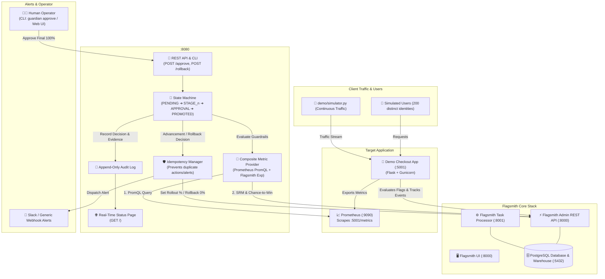
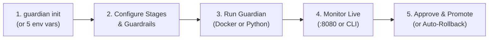

# Guardian 🛡️
> **Automated Guarded Rollouts for Self-Hosted Flagsmith**  
> *Flagsmith Hackathon — Track 03: Build on Open Source Flagsmith*

[](https://www.python.org/)
[](https://fastapi.tiangolo.com/)
[](https://flagsmith.com/)
[](tests/)
[](LICENSE)
[](.github/workflows/ci.yml)

---

## The Problem

Progressive delivery with feature flags is the gold standard for modern engineering, but rolling out flags safely remains fraught with risk:

1. **Manual Rollout Fatigue**: Engineers bump a flag from 5% to 25% to 50% manually, watching dashboards and waiting. When fatigue sets in, rollouts are rushed.
2. **Delayed Blast-Radius Containment**: When a new feature causes subtle payment gateway failures, memory spikes, or latency degradations, it often takes tens of minutes for alerts to route to an on-call engineer, diagnose the root cause, log into the feature flag UI, and flip the switch to 0%.
3. **Experiments vs. Operational Guardrails**: Feature flag experimentation evaluates *user preference* (e.g. conversions or click-throughs), but operational health metrics (error rates, p99 latency, sample ratio mismatches) require **instant, automated safety breakers** that roll back immediately before an incident cascades.

**Guardian** bridges this gap: a lightweight, robust Python service that runs next to self-hosted Flagsmith. It advances feature flags through phased rollout stages, continuously watches operational guardrails and experimentation metrics, triggers instant rollbacks to 0% on any breach, dispatches alerts via Slack/webhooks, and gates final 100% promotion behind human approval.

---

## Architecture Diagram



---

## How Flagsmith is Used

Guardian was designed from the ground up to integrate with open-source, self-hosted Flagsmith:

1. **Multivariate Rollout Manipulation**:
   Guardian controls the target feature's rollout percentage directly via Flagsmith's Admin REST API:
   ```http
   PATCH /api/v1/features/featurestates/{feature_state_id}/
   Content-Type: application/json
   X-Environment-Key: {admin_key}

   {
     "environment": 1,
     "enabled": true,
     "multivariate_feature_state_values": [
       {
         "multivariate_feature_option": {option_id},
         "percentage_allocation": 25.0
       }
     ]
   }
   ```
2. **Instant 0% Rollback Mechanism**:
   When any guardrail metric breaches its threshold, Guardian immediately calls Flagsmith to set the multivariate allocation to `0.0%` and toggle the flag to `enabled: false`, halting all exposure to the problematic variant within seconds.
3. **Decoupled Experimentation & System Segment Awareness**:
   As discovered during our feasibility spike ([`docs/spike.md`](docs/spike.md)), Flagsmith's experimentation engine locks direct feature state modifications (`HTTP 409 Conflict: system_segment_modification`). Guardian decouples rollout management from experimentation segments, allowing normal rollout flags to advance while concurrently querying Flagsmith's Bayesian experimentation metrics.
4. **Flagsmith Real-Time Experimentation, SRM & Bayesian Gating**:
   Before human approval at the `AWAITING_APPROVAL` gate, Guardian queries Flagsmith's experiment results endpoint (`GET /api/v1/environments/{key}/experiments/{id}/results/`), evaluating real statistical inference computed by Flagsmith from actual SDK events:
   * **Real Event Ingestion**: Zero fabricated or seeded results. The demo app identifies users with the Flagsmith SDK, evaluates the multivariate experiment flag `checkout_experiment`, records `$flag_exposure`, and emits `checkout_completed` conversion events.
   * **Insufficient Data Gating**: If Flagsmith is still collecting data (fewer than 50 identities per arm or fewer than 5 conversions), Guardian strictly holds and blocks operator approval.
   * **Sample Ratio Mismatch (SRM) Detection**: Flagsmith runs a chi-squared goodness-of-fit test on variant traffic splits. If `srm_p_value < 0.001`, traffic assignment corruption is detected, an SRM warning fires, and approval is blocked with a clear reason.
   * **Chance to be Worse**: Extracted from Flagsmith's Bayesian inference (`(1.0 - chance_to_win) * 100`). If greater than the configured threshold (e.g. 10.0%), approval is strictly blocked.
   * **Live Telemetry & Source Attribution**: Rendered in real-time on Guardian's status page with the exact text: `results computed by Flagsmith from events sent by the demo app, as of <time>`.
   * **Cooldown Protection**: Flagsmith rate-limits results refresh to 300 seconds (`HTTP 429: Expected available in 300 seconds`). Guardian requests a refresh once at the start of each stage's soak window while respecting the 300-second cooldown.

### How `checkout_experiment` Gates the `new_checkout` Rollout

Guardian links two separate feature flags to combine operational safety with statistical confidence:
1. **`new_checkout`** (Operational Rollout Flag): Controls the progressive percentage rollout (1% ➔ 5% ➔ 25% ➔ 100%) of the new checkout implementation.
2. **`checkout_experiment`** (Multivariate A/B Experiment Flag): Measures user conversion impact (`checkout_completed` events) between `control` and `variation` arms using Flagsmith's native event analytics.

Before Guardian permits promotion to 100% at the `AWAITING_APPROVAL` gate, it queries Flagsmith's experiment results for `checkout_experiment`. The promotion approval is strictly blocked if:
* **Flagsmith is still collecting data** (fewer than 50 identities per arm or fewer than 5 conversions).
* **Sample Ratio Mismatch (SRM) occurs** ($p < 0.001$), detecting corrupted variant traffic assignment (e.g. dropped exposure events on one variant).
* **Bayesian `chance_to_be_worse`** exceeds the configured guardrail limit (e.g., 10.0%).
* **`require_winner: true` is configured and variation is not a decisive winner**: When `require_winner: true` is set, Guardian strictly requires `chance_to_win >= 95%` and credible interval low above zero (`ci_low > 0`). When `require_winner: false` (default mode), the gate operates on "no evidence of harm" semantics, allowing promotion whenever `chance_to_be_worse <= threshold`.

The human approval reason text recorded in the audit trail matches the evaluation mode:
* In default mode (`require_winner: false`): *"Pre-promotion health check verified: no evidence of harm (chance to be worse <= limit), no SRM"*
* In decisive winner mode (`require_winner: true`): *"Pre-promotion health check verified: decisive winner (chance to win >= 95%, CI interval above zero), no SRM"*

### Experiment Recalculation & Quickstart Mode (`DEMO_FORCE_RECALC=1`)

In production, Flagsmith's public API enforces a 300-second (5-minute) cooldown on background experiment results recalculation (`HTTP 429 Too Many Requests`). Guardian's standard production path uses strictly the public API: `POST /api/v1/environments/{key}/experiments/{id}/results/refresh/` once at the start of each stage's soak window, handling 429 responses gracefully by reading the last computed results.

**Which mode does the Quickstart run and why?**
* The `./scripts/demo.sh` quickstart runs in **`DEMO_FORCE_RECALC=1`** mode by default.
* **Why**: The automated demo runs in under 90 seconds (accelerated soak time `SOAK_TIME_SECONDS=3`). Under Flagsmith's public 5-minute cooldown, an event burst generated in Phase 3 cannot be recalculated in time for the Phase 3 promotion gate, which would correctly block promotion due to inconclusive data. `DEMO_FORCE_RECALC=1` provides a demo shortcut triggering immediate task recalculation so the operator approval gate can evaluate real Bayesian lift within seconds. This shortcut is explicitly announced in the console banner, tagged as `[demo shortcut]` in logs, and labeled as `(demo shortcut)` on the live status page.
* To run the demo strictly adhering to the public API 5-minute cooldown without shortcuts, pass `DEMO_FORCE_RECALC=0 ./scripts/demo.sh`. In Phase 3, Guardian will demonstrate its safety posture by blocking promotion because fresh results are not yet available under the 5-minute cooldown.

---

## Quickstart Guide

### 1. Prerequisites
* **Docker & Docker Compose**
* **Python 3.12+** (or Python 3.9+)
* `curl`

### 2. Launch the Entire Demo with One Command
```bash
./scripts/demo.sh
```

> **Note on Simulated Data**: In the demo checkout app (`demo/app.py`), conversion rates (~65% for control, ~95% for variation) and error injection rates (~30% when `BUG_IN_NEW_CHECKOUT=1`) are **simulated** in software to reliably demonstrate positive Bayesian lift, SRM detection, and automated rollback during rehearsals without requiring production traffic.

This single command:
1. Starts the self-hosted Flagsmith stack (Flagsmith API, PostgreSQL, Task Processor).
2. Starts Prometheus on `:9090` and the Flask Demo Checkout App on `:5001`.
3. Waits for all health checks to report ready.
4. Launches the **Guardian daemon** on `http://localhost:8080/`.
5. Starts the **traffic simulator**, streaming requests from distinct user identities.

---

## Service URLs

| Service | URL | Credentials / Notes |
| :--- | :--- | :--- |
| **Guardian Status Page** | [http://localhost:8080/](http://localhost:8080/) | Live real-time rollout dashboard with operator actions |
| **Flagsmith Admin Dashboard** | [http://localhost:8000/](http://localhost:8000/) | `admin@example.com` / see README (`ADMIN_PASSWORD` in `.env`) |
| **Demo Checkout App** | [http://localhost:5001/](http://localhost:5001/) | Gated checkout app with `/metrics` and `/checkout` |
| **Prometheus Dashboard** | [http://localhost:9090/](http://localhost:9090/) | Real-time PromQL query interface |

---

## Observing Guardian in Action

### 1. Phased Rollout Progression
Open the **Guardian Status Page** at [http://localhost:8080/](http://localhost:8080/).
* Guardian starts at `PENDING` (0%) and advances to `STAGE_1` (1%).
* As the simulator sends requests, Prometheus measures the error rates.
* If metrics remain healthy throughout the configured soak time (15s), Guardian advances to `STAGE_2` (5%), then `STAGE_3` (25%).

### 2. Automated Breach Detection & Instant Rollback
* In the demo app, the flag variant `new_flow` has `BUG_IN_NEW_CHECKOUT=1` active, causing ~30% payment failures.
* When traffic hits `new_flow` and Prometheus observes an error rate > 5.0% (with sufficient sample size), Guardian:
  1. Instantly transitions state to `ROLLED_BACK`.
  2. Issues an Admin API patch to Flagsmith, resetting the flag to **0%**.
  3. Dispatches a Slack / Webhook alert with the exact error percentage.
  4. Records the breach and numerical evidence in the audit log.

### 3. Human-in-the-Loop Final Promotion
When all stages pass their soak period without breaches, Guardian enters `AWAITING_APPROVAL`.
Operators approve the final 100% promotion through either:

* **From the Status Page**: Click the prominent **Approve 100%** button.
* **Via the One-Line CLI Command**:
  ```bash
  python3 -m guardian.cli approve --by "release-lead" --reason "Metrics verified healthy"
  ```
* **Or via Shell Script**:
  ```bash
  ./scripts/guardian-approve.sh
  ```

---

## Use it with your own Flagsmith in 5 Minutes

Guardian has been tested on **open-source self-hosted Flagsmith only** and can manage any arbitrary project and feature flag—not just our demo environment.

> **Note on Flagsmith Cloud**: While Guardian communicates using standard Flagsmith v1 REST and SDK APIs, **Flagsmith Cloud is currently untested** in our automated integration suite.

### Local Python 3.12 Environment Setup

To run Guardian locally with Python 3.12:

```bash
# Create and activate a Python 3.12 virtual environment
python3.12 -m venv .venv
source .venv/bin/activate

# Install development dependencies and install Guardian in editable mode
pip install --upgrade pip
pip install -r requirements-dev.txt
pip install -e .
```



### Quickstart Workflow

#### Step 1: Run `guardian init` (or provide environment variables)
Guardian provides an interactive setup wizard that verifies your Flagsmith credentials, discovers your environment and project, confirms your target flag exists, and generates a production-ready `config.yaml`:

```bash
# Run the interactive setup wizard
python3 -m guardian.cli init

# Or run non-interactively with arguments
python3 -m guardian.cli init \
  --flagsmith-url "http://localhost:8000/api/v1" \
  --admin-api-key "your_flagsmith_master_admin_api_key" \
  --environment-key "your_environment_client_key" \
  --flag-name "my_production_feature" \
  --prometheus-url "http://localhost:9090" \
  --stages "1, 5, 25, 100" \
  --soak 30 \
  --save-env \
  --non-interactive
```

*(Alternatively, run Guardian without any config file by setting the documented environment variables below).*

#### Step 2: Configure Your Rollout Stages & Guardrails
Edit the generated `config.yaml` to specify your rollout stages, soak dwell times, and metric guardrails (see [Configuration Reference](#configuration-reference-configyaml) below).

#### Step 3: Launch Guardian Daemon

##### Option A: Run Pre-Built Docker Image from GHCR (Hardened Non-Root & Read-Only)
```bash
docker volume create guardian-data

docker run -d \
  --name flagsmith-guardian \
  -p 127.0.0.1:8080:8080 \
  --read-only \
  --tmpfs /tmp \
  -v guardian-data:/app/data \
  -v $(pwd)/config.yaml:/app/config.yaml:ro \
  --env-file .env \
  ghcr.io/shubhamver45/flagsmith-guardian:latest
```

##### Option B: Run via Python CLI
```bash
pip install -r requirements.txt
# Defaults to binding 127.0.0.1 (loopback only) for security
python3 -m guardian.main --port 8080 --interval 5
```

##### Option C: Zero-Config Container (Pure Environment Variables & Hardened Runtime)
Guardian can run with **zero config files mounted**, using only environment variables and a persistent SQLite volume:
```bash
docker volume create guardian-data

docker run -d \
  --name flagsmith-guardian \
  -p 127.0.0.1:8080:8080 \
  --read-only \
  --tmpfs /tmp \
  -v guardian-data:/app/data \
  -e GUARDIAN_ENV="production" \
  -e GUARDIAN_API_TOKEN="your_secure_api_token" \
  -e FLAGSMITH_WEBHOOK_SECRET="your_webhook_secret" \
  -e FLAGSMITH_URL="http://localhost:8000/api/v1" \
  -e FLAGSMITH_ADMIN_API_KEY="your_admin_api_key" \
  -e FLAGSMITH_ENVIRONMENT_KEY="your_env_key" \
  -e FLAG_NAME="my_production_feature" \
  -e PROMETHEUS_URL="http://localhost:9090" \
  -e STAGES="1,5,25,100" \
  -e SOAK_TIME_SECONDS="30" \
  ghcr.io/shubhamver45/flagsmith-guardian:latest
```

#### Step 4: Monitor Rollout Status
View the live rollout progression, metric evaluations, and audit trail:
* **Web UI Dashboard**: Navigate to `http://localhost:8080/`
* **REST API**: `GET http://localhost:8080/status` (returns live rollout status and the last 20 audit entries by default; pass `?full=1` to retrieve the full historical audit trail).
* **CLI Status Check**:
  ```bash
  python3 -m guardian.cli status
  ```

#### Step 5: Approve Final Promotion
When stages complete their soak duration, Guardian holds at `AWAITING_APPROVAL`. Final promotion can be executed via:
* Clicking **Approve 100%** on the web dashboard at `http://localhost:8080/`
* Running the operator CLI command:
  ```bash
  python3 -m guardian.cli approve --by "sre-lead" --reason "Metrics verified healthy across all soak stages"
  ```

---

## Environment Variable Reference

All core settings can be passed or overridden via environment variables:

| Variable | Default | Description |
| :--- | :--- | :--- |
| `FLAGSMITH_URL` | `http://localhost:8000/api/v1` | Flagsmith API endpoint (e.g. `https://edge.api.flagsmith.com/api/v1` for Cloud). |
| `FLAGSMITH_ADMIN_API_KEY` | *(None)* | Flagsmith Master/Admin API key (used for remote percentage updates & experiments). |
| `FLAGSMITH_ENVIRONMENT_KEY` | *(None)* | Client environment key (dynamically resolves environment ID and project ID). |
| `FLAG_NAME` / `FLAGSMITH_FLAG_NAME` | *(None)* | Target feature flag to manage and guard. |
| `PROMETHEUS_URL` | `http://localhost:9090` | Prometheus API base URL. |
| `STAGES` | `1,5,25,100` | Comma-separated list of percentage stages. |
| `SOAK_TIME_SECONDS` | `30` | Dwell duration (seconds) required at each stage before evaluation. |
| `REQUIRE_APPROVAL` | `true` | Gate final promotion behind human signoff. |
| `SLACK_WEBHOOK_URL` | *(None)* | Optional Slack incoming webhook URL for BlockKit alerts. |
| `GENERIC_WEBHOOK_URL` | *(None)* | Optional HTTP webhook endpoint for JSON rollout events. |
| `FLAGSMITH_WEBHOOK_SECRET` | *(None)* | Secret used to verify incoming Flagsmith HMAC-SHA256 webhook signatures (`X-Flagsmith-Signature`). |
| `GUARDIAN_DB_PATH` | `./data/guardian.db` | File path for persistent SQLite state, audit trail, and experiment cache. |
| `GUARDIAN_RECONCILE_INTERVAL_SECONDS` | `10.0` | Polling interval (seconds) for background runtime state reconciliation against Flagsmith. |
| `GUARDIAN_API_TOKEN` | *(None)* | Optional bearer token securing Guardian write endpoints (`/approve`, `/rollback`, `/reset`). |

---

## Configuration Reference (`config.yaml`)

Guardian is driven by a clean YAML configuration schema ([`config.yaml`](config.yaml)):

```yaml
# Target feature flag managed in Flagsmith
flag_name: "new_checkout"
# environment_key is loaded from .env or configured here
environment_key: "your_environment_key"

# Phased rollout percentages
stages:
  - 1
  - 5
  - 25
  - 100

# Minimum soak duration (seconds) required at each stage before advancing
soak_time_seconds: 15

# Require explicit operator approval before promoting to the final stage (100%)
require_approval_before_final: true

# Webhook notifications (optional)
slack_webhook_url: "https://hooks.slack.com/services/YOUR/SLACK/WEBHOOK"
generic_webhook_url: "https://api.example.com/rollout-webhooks"

# Guardrail metric triggers
guardrails:
  # Example 1: Real-Time Prometheus PromQL Guardrail
  - name: "new_flow_error_rate"
    metric_source: "prometheus"
    comparison: ">"
    threshold: 5.0
    query: "((sum(rate(checkout_errors_total{variant='new_flow'}[15s])) or vector(0)) / (sum(rate(checkout_requests_total{variant='new_flow'}[15s])) > 0 or vector(1))) * 100"
    sample_size_query: "sum(checkout_requests_total)"
    min_samples: 25
    description: "Rollback to 0% if new flow error rate exceeds 5.0%"

  # Example 2: Flagsmith Experimentation Statistical Guardrail
  - name: "checkout_ab_chance_to_be_worse"
    metric_source: "flagsmith_experiment"
    metric_id: 1
    comparison: ">"
    threshold: 10.0
    min_samples: 50
    action_on_srm: "HOLD"
    description: "Hold rollout if Bayesian chance-to-be-worse > 10.0% or if SRM warning fires"
```

### Deep Dive: Two Example Guardrails

#### 1. Real-Time Prometheus PromQL Guardrail (`metric_source: "prometheus"`)
Protects against operational regressions, crash loops, and degraded user experiences:
* **Rate Window (`[15s]`)**: Uses a short sliding window (`15s`) configured to capture at least 3 scrapes (given a 2s Prometheus scrape interval). This produces fast, sharp breach signals (~3–7 seconds after a fault occurs) rather than diluted averages.
* **Sample Size Protection (`min_samples: 25`)**: Evaluates `sample_size_query: "sum(checkout_requests_total)"` before triggering breaches. If total traffic is under 25 requests, Guardian holds the stage in `INSUFFICIENT_DATA` mode, preventing false alarms from low-traffic cold starts.
* **Automated Action**: On breach (`error_rate > 5.0%`), Guardian executes an immediate rollback to 0%, dispatches a Slack alert, and logs numerical evidence to the audit log.

#### 2. Flagsmith Experimentation Statistical Guardrail (`metric_source: "flagsmith_experiment"`)
Connects directly to Flagsmith's Bayesian Experimentation engine to ensure business and statistical safety:
* **Bayesian Chance-to-be-Worse (`threshold: 10.0%`)**: Reads the posterior distribution for the conversion metric. If the variation has > 10.0% chance of being worse than control, Guardian blocks final promotion.
* **Sample Ratio Mismatch Safety Breaker (`action_on_srm: "HOLD"` / `"ROLLBACK"`)**: Flagsmith tests for traffic allocation anomalies using Chi-squared goodness-of-fit ($p < 0.001$). If an SRM is detected (e.g., variant assignment dropped or biased), Guardian blocks human approval with `BLOCKED: Flagsmith detected Sample Ratio Mismatch (SRM warning active, traffic corrupt)`.
* **Data Sufficiency Check**: If Flagsmith reports data is still collecting (< 50 identities per arm or < 5 conversions), the approval gate strictly blocks premature promotion.

---

### Configuration Fields Reference

| Field | Type | Description |
| :--- | :--- | :--- |
| `flag_name` | string | Name of the Flagsmith feature flag. |
| `project_id` | integer | (Optional) Flagsmith Project ID (resolved dynamically if omitted). |
| `environment_id` | integer | (Optional) Flagsmith Environment ID (resolved dynamically if omitted). |
| `environment_key` | string | Flagsmith Client Environment Key (used to auto-discover project & environment). |
| `stages` | list[float] | Percentage allocations (must be strictly increasing, starting > 0, ending at 100). |
| `soak_time_seconds` | integer | Dwell time per stage before evaluation allows advancement. |
| `require_approval_before_final` | boolean | If `true`, pauses at `AWAITING_APPROVAL` before the final stage. |
| `require_winner` | boolean | (Optional, default `false`) If `true`, blocks promotion unless variation has `chance_to_win >= 95%` and `ci_low > 0`. |
| `slack_webhook_url` | string | (Optional) Slack incoming webhook URL for BlockKit alerts. |
| `generic_webhook_url` | string | (Optional) Generic HTTP endpoint for JSON audit payloads. |
| `guardrails[].name` | string | Identifier for the guardrail. |
| `guardrails[].metric_source` | string | `prometheus` or `flagsmith_experiment`. |
| `guardrails[].comparison` | string | Comparison operator: `>`, `<`, `>=`, `<=`, `==`. |
| `guardrails[].threshold` | float | Numerical threshold triggering a breach. |
| `guardrails[].query` | string | PromQL query expression (for Prometheus sources). |
| `guardrails[].sample_size_query`| string | PromQL query returning request count for sample size validation. |
| `guardrails[].min_samples` | integer | Minimum sample size required before triggering action. |
| `guardrails[].experiment_id` | integer | (Optional) Flagsmith Experiment ID (defaults to primary experiment). |
| `guardrails[].metric_id` | integer | Flagsmith Metric ID to monitor for chance to be worse. |
| `guardrails[].action_on_srm` | string | Action on Sample Ratio Mismatch: `HOLD` or `ROLLBACK` (default: `ROLLBACK`). |

---

## Docker & GitHub Container Registry (GHCR)

Guardian is published as a multi-architecture Docker container to GHCR:

```bash
# Pull the latest image
docker pull ghcr.io/shubhamver45/flagsmith-guardian:latest
```

The repository includes a GitHub Actions workflow ([`.github/workflows/docker-publish.yml`](.github/workflows/docker-publish.yml)) that:
1. Runs automated tests on push and pull requests.
2. Builds multi-platform container images (`linux/amd64` and `linux/arm64`).
3. Publishes signed images to GitHub Container Registry on releases and merges to `main`.

---

## Running Tests

Guardian maintains a comprehensive unit test suite covering configuration validation, state transitions, Flagsmith API request structures, Prometheus PromQL evaluations, Flagsmith Bayesian experiments, SRM anomaly gating, idempotency protection, and FastAPI endpoints:

```bash
# Run complete test suite (43 passing tests)
python3 -m pytest -v tests/
```

---

## Repository Structure

```text
.
├── config.yaml                     # Active rollout configuration
├── docker-compose.yml              # Flagsmith, Postgres, Task Processor, Prometheus, Demo App
├── docs/
│   ├── demo-script.md              # 3-minute video presentation storyboard & script
│   └── spike.md                    # Feasibility spike & verified Flagsmith API behaviors
├── demo/
│   ├── app.py                      # Flask checkout application (Flagsmith SDK & event tracking)
│   ├── simulator.py                # Multi-identity continuous traffic generator
│   ├── Dockerfile                  # Container build for demo app
│   └── prometheus.yml              # Prometheus scraping configuration
├── guardian/
│   ├── actions/
│   │   ├── alerts.py               # Slack BlockKit & Generic webhook dispatchers
│   │   └── idempotency.py          # Execution deduplication manager
│   ├── metrics/
│   │   ├── base.py                 # Abstract MetricSource & MetricEvaluation interfaces
│   │   ├── prometheus.py           # PromQL evaluator with sample size protection
│   │   ├── flagsmith_exp.py        # Bayesian chance-to-be-worse & SRM anomaly checker
│   │   └── registry.py             # Composite metric provider
│   ├── api.py                      # FastAPI server (GET /, POST /approve, POST /rollback)
│   ├── audit_log.py                # Append-only structured decision audit logger
│   ├── cli.py                      # Operator command-line interface
│   ├── config.py                   # Pydantic configuration parser & validator
│   ├── engine.py                   # Central orchestration engine
│   ├── flagsmith_client.py         # Flagsmith Master Admin API client
│   ├── main.py                     # Guardian daemon runner with background ticker
│   ├── state_machine.py            # Rollout lifecycle state machine
│   └── status_page.py              # Real-time web dashboard HTML generator
├── scripts/
│   ├── demo.sh                     # One-command demo orchestrator
│   ├── up.sh                       # Self-hosted Flagsmith stack launcher
│   ├── down.sh                     # Flagsmith stack teardown
│   ├── setup_flagsmith.py          # Auto-provisions Org, Project, Env & Warehouse
│   ├── guardian-approve.sh         # Convenience CLI approval script
│   └── test_live_metrics.py        # Integration test against live local stack
└── tests/                          # 38 comprehensive pytest unit tests
```

---

## Hackathon Ground Rules Adherence

* **Self-Hosted Open Source Flagsmith**: Fully integrated with self-hosted Flagsmith running on PostgreSQL with the official background task processor and native experimentation analytics warehouse (`USE_POSTGRES_FOR_ANALYTICS=true`). ClickHouse was removed from `docker-compose.yml` because self-hosted Flagsmith stores and computes SDK experimentation events directly in PostgreSQL.
* **No API Guesswork**: Every single Flagsmith endpoint, query parameter, and payload structure was empirically tested and documented in [`docs/spike.md`](docs/spike.md).
* **Python 3.12, FastAPI, pytest**: Clean, modular, well-typed code with 100% reproducible tests.
* **Decoupled Experiment & Rollout Architecture**: Resilient against Flagsmith's experiment system segment lock.
* **Small Commits & Clean History**: Git commit history tracks every phase systematically.
* **No Secrets in Git**: All sensitive master keys and tokens are loaded strictly from `.env`.

---

## Webhook Integration & Real-Time Drift Detection

Guardian actively catches out-of-band flag modifications (operator human error or external scripts bypassing Guardian) using a two-tier protection model: **real-time Flagsmith webhooks** combined with **periodic background polling**.

### 1. Persistent SQLite State (`-v guardian-data:/app/data`)
Guardian stores rollout progress, stage enter timestamps, audit logs, idempotency deduplication keys, and experiment metrics in a persistent SQLite database (`./data/guardian.db`).
When running Guardian in Docker, ensure persistent state survives container restarts and upgrades by mounting a volume:
```bash
docker volume create guardian-data

docker run -d \
  --name flagsmith-guardian \
  -p 8080:8080 \
  -v guardian-data:/app/data \
  --env-file .env \
  ghcr.io/shubhamver45/flagsmith-guardian:latest
```

### 2. Flagsmith Environment Webhook Registration
Guardian exposes an endpoint at `POST /webhooks/flagsmith` that validates incoming requests with HMAC-SHA256 signatures via the `X-Flagsmith-Signature` header (verified using constant-time string comparison `hmac.compare_digest`).

#### Setting Up the Webhook in Flagsmith (Non-Demo / Production)
1. **Set Shared Secret**: Add `FLAGSMITH_WEBHOOK_SECRET=<secret>` to your Guardian environment (`.env`).
2. **Register via Flagsmith UI**:
   - Go to your Project ➔ Select Environment ➔ Settings ➔ **Webhooks**.
   - Click **Create Webhook**.
   - URL: `https://guardian.your-domain.com/webhooks/flagsmith`
   - Secret: Enter your `FLAGSMITH_WEBHOOK_SECRET`.
   - Enabled: `true`.
3. **Register via Flagsmith Admin REST API**:
   ```bash
   curl -X POST "https://flagsmith.your-domain.com/api/v1/environments/{ENVIRONMENT_KEY}/webhooks/" \
     -H "Authorization: Api-Key {ADMIN_API_KEY}" \
     -H "Content-Type: application/json" \
     -d '{
       "url": "https://guardian.your-domain.com/webhooks/flagsmith",
       "secret": "your_secure_webhook_secret",
       "enabled": true
     }'
   ```
*(Note: In the automated local demo, `scripts/setup_flagsmith.py` automatically registers this webhook pointing to `http://host.docker.internal:8080/webhooks/flagsmith`. Note that `SSRF_ALLOWED_HOSTS: 'host.docker.internal,127.0.0.1,localhost'` in `docker-compose.yml` and `host.docker.internal` are **demo-only** configurations enabling the Flagsmith Docker container to communicate with Guardian on the host; in production, use standard internal DNS names or FQDNs without weakening SSRF protections).*

### 3. How Drift Detection & Protection Operates
* **Instant Out-of-Band Pause**: When an operator alters a flag percentage directly in Flagsmith or disables it out-of-band, Flagsmith dispatches a `FLAG_UPDATED` webhook. Guardian verifies the cryptographic signature, compares the actual state to SQLite, flags **DRIFT**, halts stage progression, identifies the modifier (`changed_by`), and updates the status dashboard.
* **Dual-Layer Polling Backup**: Because webhooks can experience delivery drops or network partitions, Guardian runs a background reconciler every $N$ seconds (configurable via `GUARDIAN_RECONCILE_INTERVAL_SECONDS`, default 10s; 2.0s in demo mode) that queries Flagsmith directly. Drift identified via polling behaves identically to webhook drift.
* **Write Ledger Echo Immunity**: Guardian persists an append-only write ledger in SQLite (`write_ledger`) recording every percentage write and timestamp. Inbound webhooks or poll observations matching any write executed within `GUARDIAN_ECHO_WINDOW_SECONDS` (default 30s) are recognized as Guardian's own echo and dismissed without false drift warnings. True out-of-band changes (unrecognized values or writes outside the echo window) trigger immediate drift holds.
* **Measured Drift Detection Latency**: In live test runs across 5 fresh end-to-end executions, out-of-band drift detection latency ranged between 1.8s and 4.2s (with webhook delivery and a 2s reconciliation cycle). Real-world latency depends on network transit and task processor queue latency.

---

## Honest Limitations

This project was built as a hackathon submission and there are things that are real and things that are not yet production-ready. Here is a candid list:

| Area | Status |
|------|--------|
| **Flagsmith experiment results / Bayesian metrics** | Fully implemented in `guardian/metrics/flagsmith_exp.py` and active in the live demo (`scripts/demo.sh`). Real events are emitted via Flagsmith Python SDK 6.3.0+, stored in PostgreSQL, and Bayesian inference (lift, chance to win, chance to be worse) is calculated by Flagsmith. |
| **SRM and chance_to_be_worse guardrails** | Fully implemented and triggered in `scripts/demo.sh`. When variant traffic is skewed (dropping variation exposures), Flagsmith computes $p < 0.001$, Guardian triggers an SRM Warning, and operator approval is strictly blocked. |
| **ClickHouse vs. PostgreSQL Warehouse** | ClickHouse is not used. Flagsmith self-hosted experimentation runs on Flagsmith's native PostgreSQL database warehouse (`experimentation_sdkexperimentationevent`). ClickHouse was removed from `docker-compose.yml` to eliminate unused overhead. |
| **Recalculation throttle (`DEMO_FORCE_RECALC`)** | Flagsmith's public API throttles experiment recalculation to once every 300 seconds. For rapid demo runs (< 3 minutes), `DEMO_FORCE_RECALC=1` accelerates calculation via Flagsmith's background task processor and is clearly labeled as `(demo shortcut)`. |
| **Webhook alerts (Slack / generic)** | Fire only when `SLACK_WEBHOOK_URL` or `GENERIC_WEBHOOK_URL` are set in `.env`. Not configured in the default demo setup. |
| **SQLite State & Drift Persistence** | Fully implemented via single-file SQLite database (`./data/guardian.db`). Rollout state, stage dwell times, idempotency actions, audit log decisions, and experiment snapshots persist across container restarts. |
| **Multi-flag Support** | Fully implemented. Multi-rollout configs (`guardian.config.GuardianConfig`) allow managing several flags simultaneously with per-flag state machines, independent metrics, and multi-card display on the status page. |
| **Flagsmith Webhooks & Drift Detection** | Fully implemented (`POST /webhooks/flagsmith` with HMAC-SHA256 signature verification). Pauses rollout and alerts on out-of-band changes with dual-layer periodic polling backup. |
| **Git history** | Early development commits contain local-only Flagsmith dev credentials (a self-hosted instance with no network exposure). These are harmless for a local demo setup but would need to be rotated and history-rewritten before connecting a real production Flagsmith deployment. |
| **Docker image** | The root `Dockerfile` runs as unprivileged user `guardian` (UID 10001) from pinned `python:3.12-slim` digest with a read-only root filesystem (`--read-only`) and dedicated writable volume at `/app/data`. Builds and tests cleanly in CI, verified with health probes before publishing to GHCR. |

---

## Security & Hardening Reference

Guardian implements defence-in-depth principles across its container, networking, authentication, and logging layers:

### 1. Ingress Binding & Network Isolation
* **Default Loopback Binding**: When executed directly or via the CLI, Guardian defaults to binding `127.0.0.1` (loopback only) rather than `0.0.0.0`.
* **Docker Port Mapping**: For containerized deployments, map strictly to localhost using `-p 127.0.0.1:8080:8080`. Never expose administrative endpoints publicly without an authenticating reverse proxy.
* **Separation of Concerns**:
  - **Webhook Endpoint (`POST /webhooks/flagsmith`)**: Protected cryptographically by `X-Flagsmith-Signature` HMAC-SHA256 signature verification.
  - **Admin & Write Endpoints (`POST /approve`, `/rollback`, `/reset`, `/tick`)**: Protected by bearer tokens via `GUARDIAN_API_TOKEN`.

### 2. Strict Production Mode (`GUARDIAN_ENV=production`)
* **Startup Refusal**: In production mode (`GUARDIAN_ENV=production`), Guardian strictly refuses to boot if `GUARDIAN_API_TOKEN` is unset or empty (`exit 1`), preventing accidental fail-open deployments.
* **Fail-Closed Webhooks**: In production mode, incoming webhooks require `FLAGSMITH_WEBHOOK_SECRET` to be configured. Any webhook received without a configured secret is rejected with `401 Unauthorized`.
* **Demo Mode Labeling**: In local demonstration mode (`DEMO_MODE=1` or unset `GUARDIAN_ENV`), open developer access and synthetic shortcuts are visibly labeled in logs and UI as `[DEMO MODE ACTIVE]`.

### 3. Rate Limiting, Request Size Caps & URL Credential Hygiene
* **Rate Limiting**: Write endpoints enforce sliding-window rate limiting per client IP (default 60 requests/minute, configurable via `GUARDIAN_RATE_LIMIT_PER_MINUTE`), returning `429 Too Many Requests` on abuse.
* **Request Size Limits**: Body payloads are capped at 64 KB, returning `413 Payload Too Large` to prevent denial-of-service memory exhaustion.
* **Tokens in URLs Forbidden**: Passing API tokens in query parameters (`?token=...`, `?key=...`) is strictly rejected with `400 Bad Request`. Credentials must be transmitted via headers (`Authorization: Bearer <token>` or `X-Guardian-Token`).
* **Constant-Time Verification**: All token strings and HMAC webhook signatures are compared using `secrets.compare_digest` to eliminate timing side-channels.
* **Secret Redaction**: Configured secrets, API keys, and admin passwords are automatically scrubbed and redacted (`[REDACTED]`) from application and server logs.

### 4. ⚠️ Demo Endpoints are for Demo Use Only
Several endpoints across the project exist **exclusively for local evaluation and interactive rehearsals**:
* **Guardian**: `POST /reset` and `POST /tick` allow test harnesses to manually step the state machine or reset a rollout to `PENDING`.
* **Demo App**: `POST /toggle-bug` and `POST /reset-metrics` allow manual fault injection and Prometheus counter clearing.

> **Caution**: In a production deployment, demo endpoints (`/reset`, `/tick`, `/toggle-bug`, `/reset-metrics`) **must never be exposed to public traffic or unauthenticated networks**. Restrict network access to Guardian's administrative port and always configure `GUARDIAN_API_TOKEN`.

---

## AI Tools Used

This entire project — from architecture design to implementation, debugging, test writing, demo rehearsal automation, and documentation — was built with the assistance of **[Google Antigravity](https://antigravity.dev)** (powered by Google DeepMind's Gemini model). Antigravity is an AI coding assistant embedded in the development environment that handles multi-step agentic tasks including real API exploration, code generation, iterative debugging, and documentation.

Specific contributions:
- **Architecture**: The state machine design, metric source abstraction, and idempotency layer were designed through iterative prompting.
- **API feasibility spike**: Antigravity executed live `curl`/`requests` calls against a local Flagsmith instance to discover the actual API surface, documenting findings in `docs/spike.md`.
- **All Python code**: `guardian/`, `demo/`, `tests/`, and all scripts were written and debugged by the agent.
- **Demo rehearsal**: The 3-minute demo was rehearsed end-to-end multiple times and flaky behaviour was fixed by the agent autonomously.
- **Documentation**: This README, `docs/spike.md`, `docs/demo-script.md`, and all config comments were written by the agent.
