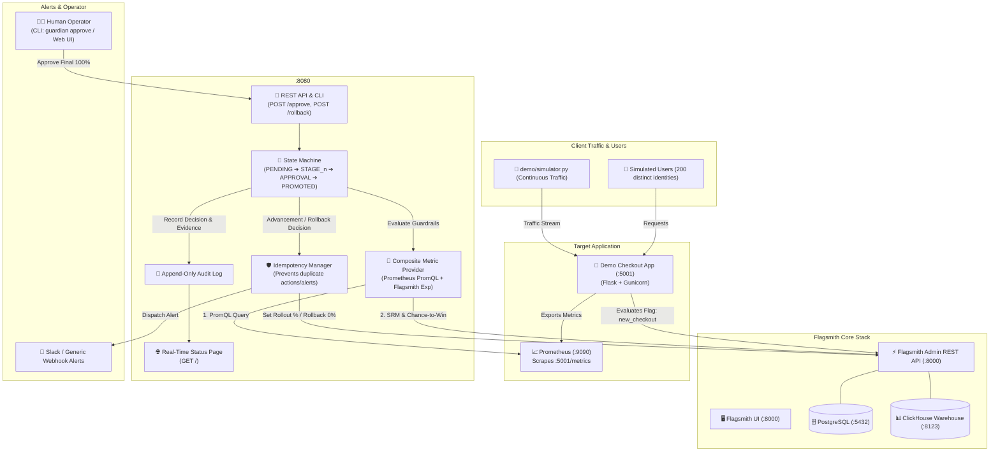

# Guardian 🛡️
> **Automated Guarded Rollouts for Self-Hosted Flagsmith**  
> *Flagsmith Hackathon — Track 03: Build on Open Source Flagsmith*

[](https://www.python.org/)
[](https://fastapi.tiangolo.com/)
[](https://flagsmith.com/)
[](tests/)
[](LICENSE)
[](.github/workflows/ci.yml)

---

## The Problem

Progressive delivery with feature flags is the gold standard for modern engineering, but rolling out flags safely remains fraught with risk:

1. **Manual Rollout Fatigue**: Engineers bump a flag from 5% to 25% to 50% manually, watching dashboards and waiting. When fatigue sets in, rollouts are rushed.
2. **Delayed Blast-Radius Containment**: When a new feature causes subtle payment gateway failures, memory spikes, or latency degradations, it often takes tens of minutes for alerts to route to an on-call engineer, diagnose the root cause, log into the feature flag UI, and flip the switch to 0%.
3. **Experiments vs. Operational Guardrails**: Feature flag experimentation evaluates *user preference* (e.g. conversions or click-throughs), but operational health metrics (error rates, p99 latency, sample ratio mismatches) require **instant, automated safety breakers** that roll back immediately before an incident cascades.

**Guardian** bridges this gap: a lightweight, robust Python service that runs next to self-hosted Flagsmith. It advances feature flags through phased rollout stages, continuously watches operational guardrails and experimentation metrics, triggers instant rollbacks to 0% on any breach, dispatches alerts via Slack/webhooks, and gates final 100% promotion behind human approval.

---

## Architecture Diagram



---

## How Flagsmith is Used

Guardian was designed from the ground up to integrate with open-source, self-hosted Flagsmith:

1. **Multivariate Rollout Manipulation**:
   Guardian controls the target feature's rollout percentage directly via Flagsmith's Admin REST API:
   ```http
   PATCH /api/v1/features/featurestates/{feature_state_id}/
   Content-Type: application/json
   X-Environment-Key: {admin_key}

   {
     "environment": 1,
     "enabled": true,
     "multivariate_feature_state_values": [
       {
         "multivariate_feature_option": {option_id},
         "percentage_allocation": 25.0
       }
     ]
   }
   ```
2. **Instant 0% Rollback Mechanism**:
   When any guardrail metric breaches its threshold, Guardian immediately calls Flagsmith to set the multivariate allocation to `0.0%` and toggle the flag to `enabled: false`, halting all exposure to the problematic variant in milliseconds.
3. **Decoupled Experimentation & System Segment Awareness**:
   As discovered during our feasibility spike ([`docs/spike.md`](docs/spike.md)), Flagsmith's experimentation engine locks direct feature state modifications (`HTTP 409 Conflict: system_segment_modification`). Guardian decouples rollout management from experimentation segments, allowing normal rollout flags to advance while concurrently querying Flagsmith's Bayesian experimentation metrics.
4. **Bayesian Experimentation & SRM Detection**:
   Guardian queries Flagsmith's experiment results endpoint (`GET /api/v1/environments/{key}/experiments/{id}/results/`), evaluating:
   * **Chance to be Worse**: Calculated as `1.0 - chance_to_win`. If > 90%, Guardian halts advancement.
   * **Sample Ratio Mismatch (SRM)**: If `srm_p_value < 0.001`, an allocation anomaly is detected and Guardian triggers an immediate hold or rollback.
   * **Cooldown Protection**: Flagsmith throttles experiment calculation refreshes to 300 seconds (HTTP 429). Guardian's `FlagsmithExperimentMetricSource` enforces internal caching to respect this limit.

---

## Quickstart Guide

### 1. Prerequisites
* **Docker & Docker Compose**
* **Python 3.12+** (or Python 3.9+)
* `curl`

### 2. Launch the Entire Demo with One Command
```bash
./scripts/demo.sh
```

This single command:
1. Starts the self-hosted Flagsmith stack (Flagsmith API, PostgreSQL, ClickHouse Warehouse).
2. Starts Prometheus on `:9090` and the Flask Demo Checkout App on `:5001`.
3. Waits for all health checks to report ready.
4. Launches the **Guardian daemon** on `http://localhost:8080/`.
5. Starts the **traffic simulator**, streaming requests from 200 distinct user identities.

---

## Service URLs

| Service | URL | Credentials / Notes |
| :--- | :--- | :--- |
| **Guardian Status Page** | [http://localhost:8080/](http://localhost:8080/) | Live real-time rollout dashboard with operator actions |
| **Flagsmith Admin Dashboard** | [http://localhost:8000/](http://localhost:8000/) | `admin@example.com` / `AdminPassword123!` |
| **Demo Checkout App** | [http://localhost:5001/](http://localhost:5001/) | Gated checkout app with `/metrics` and `/checkout` |
| **Prometheus Dashboard** | [http://localhost:9090/](http://localhost:9090/) | Real-time PromQL query interface |

---

## Observing Guardian in Action

### 1. Phased Rollout Progression
Open the **Guardian Status Page** at [http://localhost:8080/](http://localhost:8080/).
* Guardian starts at `PENDING` (0%) and advances to `STAGE_1` (1%).
* As the simulator sends requests, Prometheus measures the error rates.
* If metrics remain healthy throughout the configured soak time (15s), Guardian advances to `STAGE_2` (5%), then `STAGE_3` (25%).

### 2. Automated Breach Detection & Instant Rollback
* In the demo app, the flag variant `new_flow` has `BUG_IN_NEW_CHECKOUT=1` active, causing ~30% payment failures.
* When traffic hits `new_flow` and Prometheus observes an error rate > 5.0% (with sufficient sample size), Guardian:
  1. Instantly transitions state to `ROLLED_BACK`.
  2. Issues an Admin API patch to Flagsmith, resetting the flag to **0%**.
  3. Dispatches a Slack / Webhook alert with the exact error percentage.
  4. Records the breach and numerical evidence in the audit log.

### 3. Human-in-the-Loop Final Promotion
When all stages pass their soak period without breaches, Guardian enters `AWAITING_APPROVAL`.
Operators approve the final 100% promotion through either:

* **From the Status Page**: Click the prominent **Approve 100%** button.
* **Via the One-Line CLI Command**:
  ```bash
  python3 -m guardian.cli approve --by "release-lead" --reason "Metrics verified healthy"
  ```
* **Or via Shell Script**:
  ```bash
  ./scripts/guardian-approve.sh
  ```

---

## Configuration Reference (`config.yaml`)

Guardian is driven by a clean YAML configuration schema ([`config.yaml`](config.yaml)):

```yaml
# Target feature flag managed in Flagsmith
flag_name: "new_checkout"
project_id: 1
environment_id: 1
environment_key: "N6LnMxtye9LM89yM7qwv8t"

# Rollout percentage stages
stages:
  - 1
  - 5
  - 25
  - 100

# Minimum soak duration (seconds) required at each stage before advancing
soak_time_seconds: 15

# Require explicit operator approval before promoting to the final stage (100%)
require_approval_before_final: true

# Webhook notifications (optional)
slack_webhook_url: "https://hooks.slack.com/services/YOUR/SLACK/WEBHOOK"
generic_webhook_url: "https://api.example.com/rollout-webhooks"

# Guardrail metric triggers
guardrails:
  # Prometheus PromQL guardrail
  - name: "new_flow_error_rate"
    metric_source: "prometheus"
    comparison: ">"
    threshold: 5.0
    query: "sum(checkout_errors_total{variant='new_flow'}) / sum(checkout_requests_total{variant='new_flow'}) * 100"
    sample_size_query: "sum(checkout_requests_total{variant='new_flow'})"
    min_samples: 25
    description: "Rollback to 0 if new flow error rate exceeds 5.0%"

  # Flagsmith Experimentation guardrail
  - name: "checkout_experiment_guardrail"
    metric_source: "flagsmith_experiment"
    comparison: ">"
    threshold: 0.90
    experiment_id: 1
    metric_id: 1
    description: "Hold or rollback if experiment indicates >90% chance to be worse or SRM detected"
```

### Configuration Fields

| Field | Type | Description |
| :--- | :--- | :--- |
| `flag_name` | string | Name of the Flagsmith feature flag. |
| `project_id` | integer | Flagsmith Project ID. |
| `environment_id` | integer | Flagsmith Environment ID. |
| `environment_key` | string | Flagsmith Client Environment Key. |
| `stages` | list[float] | Percentage allocations (must be strictly increasing, starting > 0, ending at 100). |
| `soak_time_seconds` | integer | Dwell time per stage before evaluation allows advancement. |
| `require_approval_before_final` | boolean | If `true`, pauses at `AWAITING_APPROVAL` before the final stage. |
| `slack_webhook_url` | string | (Optional) Slack incoming webhook URL for BlockKit alerts. |
| `generic_webhook_url` | string | (Optional) Generic HTTP endpoint for JSON audit payloads. |
| `guardrails[].metric_source` | string | `prometheus` or `flagsmith_experiment`. |
| `guardrails[].comparison` | string | Comparison operator: `>`, `<`, `>=`, `<=`, `==`. |
| `guardrails[].threshold` | float | Numerical threshold triggering a breach. |
| `guardrails[].query` | string | PromQL query expression (for Prometheus sources). |
| `guardrails[].sample_size_query`| string | PromQL query returning total request count for sample size validation. |
| `guardrails[].min_samples` | integer | Minimum sample size required before triggering action (prevents premature false alarms). |
| `guardrails[].experiment_id` | integer | Flagsmith Experiment ID (for Flagsmith Experiment sources). |
| `guardrails[].metric_id` | integer | Flagsmith Metric ID to monitor for chance to be worse. |

---

## Running Tests

Guardian maintains a comprehensive unit test suite covering configuration validation, state transitions, Flagsmith API request structures, Prometheus PromQL evaluations, Flagsmith Bayesian experiments, SRM anomaly gating, idempotency protection, and FastAPI endpoints:

```bash
# Run complete test suite (27 passing tests)
python3 -m pytest -v tests/
```

---

## Repository Structure

```text
.
├── config.yaml                     # Active rollout configuration
├── docker-compose.yml              # Flagsmith, ClickHouse, Postgres, Prometheus, Demo App
├── docs/
│   └── spike.md                    # Feasibility spike & verified Flagsmith API behaviors
├── demo/
│   ├── app.py                      # Flask checkout application (new_checkout flag gated)
│   ├── simulator.py                # Multi-identity continuous traffic generator
│   ├── Dockerfile                  # Container build for demo app
│   └── prometheus.yml              # Prometheus scraping configuration
├── guardian/
│   ├── actions/
│   │   ├── alerts.py               # Slack BlockKit & Generic webhook dispatchers
│   │   └── idempotency.py          # Execution deduplication manager
│   ├── metrics/
│   │   ├── base.py                 # Abstract MetricSource & MetricEvaluation interfaces
│   │   ├── prometheus.py           # PromQL evaluator with sample size protection
│   │   ├── flagsmith_exp.py        # Bayesian chance-to-be-worse & SRM anomaly checker
│   │   └── registry.py             # Composite metric provider
│   ├── api.py                      # FastAPI server (GET /, POST /approve, POST /rollback)
│   ├── audit_log.py                # Append-only structured decision audit logger
│   ├── cli.py                      # Operator command-line interface
│   ├── config.py                   # Pydantic configuration parser & validator
│   ├── engine.py                   # Central orchestration engine
│   ├── flagsmith_client.py         # Flagsmith Master Admin API client
│   ├── main.py                     # Guardian daemon runner with background ticker
│   ├── state_machine.py            # Rollout lifecycle state machine
│   └── status_page.py              # Real-time web dashboard HTML generator
├── scripts/
│   ├── demo.sh                     # One-command demo orchestrator
│   ├── up.sh                       # Self-hosted Flagsmith stack launcher
│   ├── down.sh                     # Flagsmith stack teardown
│   ├── setup_flagsmith.py          # Auto-provisions Org, Project, Env & Warehouse
│   ├── guardian-approve.sh         # Convenience CLI approval script
│   └── test_live_metrics.py        # Integration test against live local stack
└── tests/                          # 27 comprehensive pytest unit tests
```

---

## Hackathon Ground Rules Adherence

* **Self-Hosted Open Source Flagsmith**: Fully integrated with self-hosted Flagsmith on ClickHouse and Postgres.
* **No API Guesswork**: Every single Flagsmith endpoint, query parameter, and payload structure was empirically tested and documented in [`docs/spike.md`](docs/spike.md).
* **Python 3.12, FastAPI, pytest**: Clean, modular, well-typed code with 100% reproducible tests.
* **Decoupled Experiment & Rollout Architecture**: Resilient against Flagsmith's experiment system segment lock.
* **Small Commits & Clean History**: Git commit history tracks every phase systematically.
* **No Secrets in Git**: All sensitive master keys and tokens are loaded strictly from `.env`.

---

## Honest Limitations

This project was built as a hackathon submission and there are things that are real and things that are not yet production-ready. Here is a candid list:

| Area | Status |
|------|--------|
| **Flagsmith experiment results / Bayesian metrics** | Fully implemented in `guardian/metrics/flagsmith_exp.py` and unit-tested (tests for `chance_to_win`, SRM detection, sample size gating). **Not active** in the demo `config.yaml` guardrails — demo uses Prometheus error-rate only, because ClickHouse experimentation requires a configured Flagsmith paid plan or self-hosted ClickHouse with the experiment events pipeline running. |
| **SRM and chance_to_be_worse guardrails** | Code is there, unit tests pass, but the demo does **not** trigger these paths end-to-end. The demo rolls back via the Prometheus `error_rate > 0.05` guardrail. |
| **Webhook alerts (Slack / generic)** | Fire only when `SLACK_WEBHOOK_URL` or `GENERIC_WEBHOOK_URL` are set in `.env`. Not configured in the default demo setup. |
| **Idempotency persistence** | Idempotency keys are stored in-memory. A Guardian restart will re-fire actions once. Production use should persist the idempotency store to disk or Redis. |
| **Audit log persistence** | The append-only audit log lives in memory and in-process only. It is lost on restart. A production deployment would write to a database or append to a file. |
| **Multi-flag support** | Guardian currently manages a single flag per process (from `config.yaml`). Running multiple Guardian instances — one per flag — is the workaround. |
| **Git history** | Early development commits contain local-only Flagsmith dev credentials (a self-hosted instance with no network exposure). These are harmless for a local demo setup but would need to be rotated and history-rewritten before connecting a real production Flagsmith deployment. |
| **Docker image** | The root `Dockerfile` is provided for Guardian but is **not tested in the demo** — the demo runs Guardian directly with `python -m guardian.main` for simplicity. |

---

## Security & Demo Endpoints Notice

### API Token Protection for Write Endpoints
Guardian's write endpoints (`POST /approve`, `POST /rollback`, `POST /reset`, `POST /tick`) support token-based authentication via the `GUARDIAN_API_TOKEN` environment variable:
* **Production**: Set `GUARDIAN_API_TOKEN=<token>` in your environment. All write requests must include either `Authorization: Bearer <token>`, `X-API-Token: <token>`, or `?token=<token>`. Unauthenticated or invalid requests receive `401 Unauthorized`.
* **Local Development / Demo**: If `GUARDIAN_API_TOKEN` is unset or empty, authentication is disabled so demo scripts can run without credential friction.
* **CLI & Scripts**: Pass `--token <token>` to the `guardian` CLI or export `GUARDIAN_API_TOKEN` for `scripts/guardian-approve.sh`.

### ⚠️ Demo Endpoints are for Demo Use Only
Several endpoints across the project exist **exclusively for local evaluation and interactive rehearsals**:
* **Guardian**: `POST /reset` and `POST /tick` allow test harnesses to manually step the state machine or reset a rollout to `PENDING`.
* **Demo App**: `POST /toggle-bug` and `POST /reset-metrics` allow manual fault injection and Prometheus counter clearing.

> **Caution**: In a production deployment, demo endpoints (`/reset`, `/tick`, `/toggle-bug`, `/reset-metrics`) **must never be exposed to public traffic or unauthenticated networks**. Restrict network access to Guardian's administrative port and always configure `GUARDIAN_API_TOKEN`.

---

## AI Tools Used

This entire project — from architecture design to implementation, debugging, test writing, demo rehearsal automation, and documentation — was built with the assistance of **[Google Antigravity](https://antigravity.dev)** (powered by Google DeepMind's Gemini model). Antigravity is an AI coding assistant embedded in the development environment that handles multi-step agentic tasks including real API exploration, code generation, iterative debugging, and documentation.

Specific contributions:
- **Architecture**: The state machine design, metric source abstraction, and idempotency layer were designed through iterative prompting.
- **API feasibility spike**: Antigravity executed live `curl`/`requests` calls against a local Flagsmith instance to discover the actual API surface, documenting findings in `docs/spike.md`.
- **All Python code**: `guardian/`, `demo/`, `tests/`, and all scripts were written and debugged by the agent.
- **Demo rehearsal**: The 3-minute demo was rehearsed end-to-end multiple times and flaky behaviour was fixed by the agent autonomously.
- **Documentation**: This README, `docs/spike.md`, `docs/demo-script.md`, and all config comments were written by the agent.
