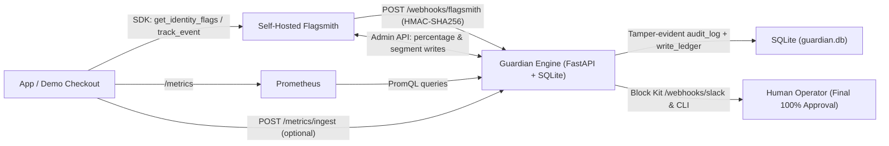

# Flagsmith Guardian Architecture

## Core Components
- **State Machine (`guardian/state_machine.py`):** `PENDING → [SEGMENT_STAGE] → STAGE_1..N → AWAITING_APPROVAL → PROMOTED` (or `PAUSED` / `ROLLED_BACK`).
- **Flagsmith Client (`guardian/flagsmith_client.py`):** Reads & updates multivariate percentages and optional segment overrides via Flagsmith Admin API with retries and timeouts.
- **Metric Sources (`guardian/metrics/`):** `prometheus`, `push` (`POST /metrics/ingest`), `flagsmith_experiment` (Bayesian + chi-squared SRM `p < 0.001`), `datadog`, and `cloudwatch`.
- **Persistence (`guardian/storage.py`):** Single-instance SQLite (`WAL` mode) storing rollout state, `write_ledger` echo-immunity records, and SHA-256 hash-chained `audit_log` entries (`GET /audit/verify`).
- **API & Dashboard (`guardian/api.py`, `guardian/status_page.py`):** Streaming 64 KB `RequestSizeLimitMiddleware` (including chunked requests), sliding-window rate limiter, constant-time Bearer/HMAC verification, and responsive status dashboard.
